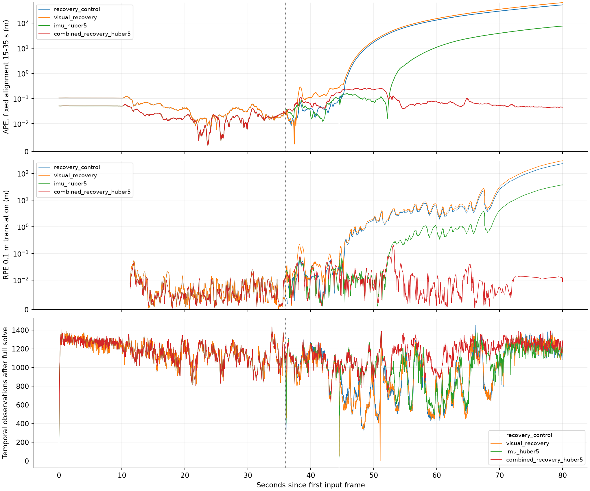
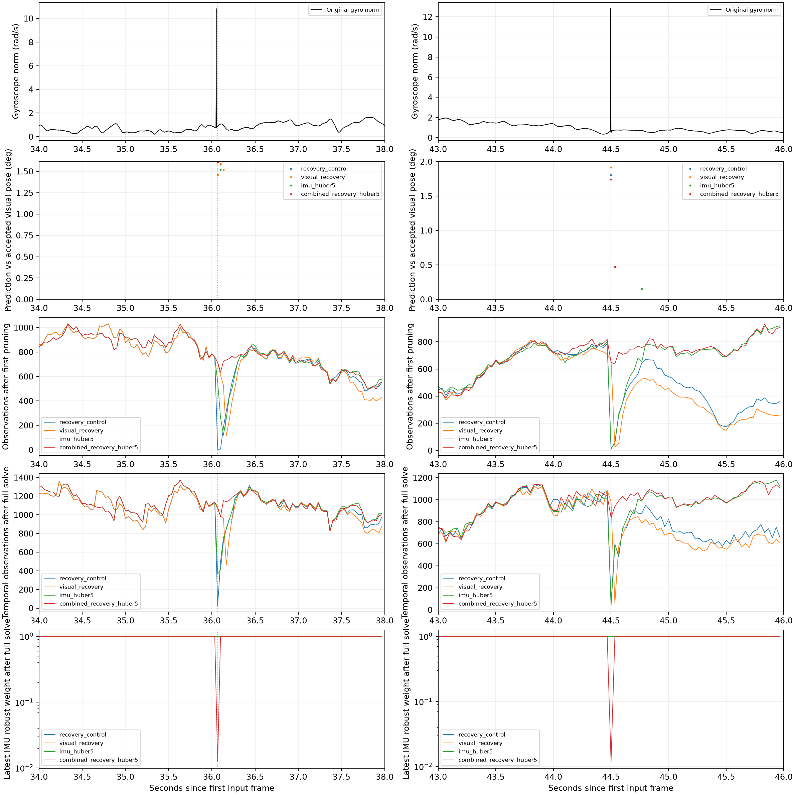
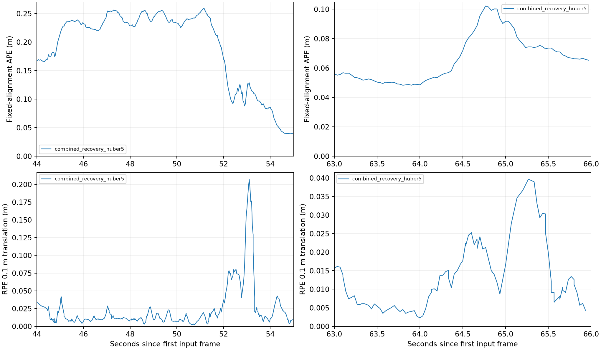
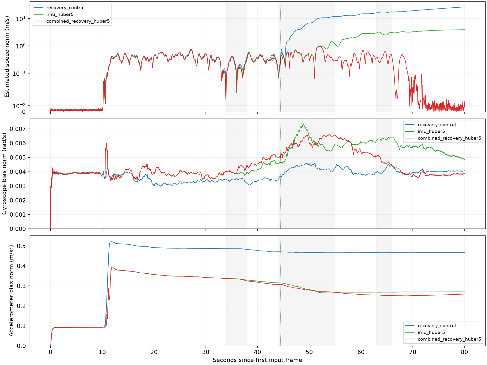

# 稳定复现模式下的 OKVIS2 VIO 漂移排查

## 结论与适用范围

本轮确认了一条可干预的退化链条：短时陀螺突变使 IMU 预测偏离视觉几何；虽然多相机 RANSAC 找到大量内点，紧随其后的 pose-only 视觉惯性优化仍强迫位姿贴近 IMU，导致外点剔除删除绝大多数有效跨帧观测。新建同帧立体观测会掩盖这种跨帧约束丢失。仅保留视觉观测还不足以阻止完整后端再次服从异常 IMU。

默认关闭的条件视觉恢复与 IMU Huber 损失组合，在原始输入上的最终三次运行均将全程 SE(3) APE RMSE 从 142.643151 m 降至 0.071376 m。此处的“改善”针对当前可重复的严重发散基线；不能等同于原始随机模式的局部漂移已经全部解决。44–55 s 仍有 20.70 cm 的 RPE 0.1 m 峰值，高于历史原始结果的 15.08 cm。

新增的 **34–38 s RPE RMSE 从 0.8094 cm 升至 1.5081 cm（+6.99 mm）**。因此即使旧窗口的相对验收项全过，也不能声称“所有其他窗口不退化”或“首次触发附近精度问题已解决”。这是一项保持轨迹复现的有效缓解，仍有明确的局部精度权衡。

历史原始 `run_20260922T172208_vio_4b5dd4` 的保存轨迹用同一评估器重新计算，APE RMSE 为 0.281814 m；未重跑该历史二进制。以下仅作背景参照，历史源码/运行模式不同，不能当作本轮单变量对照：

| RPE 0.1 m 窗口 | 历史原始 RMSE / p95 / 峰值 (cm) | 当前组合 RMSE / p95 / 峰值 (cm) |
|---|---:|---:|
| 44–55 s | 5.050 / 10.840 / 15.085 | 3.740 / 7.474 / 20.699 |
| 63–66 s | 2.676 / 5.376 / 7.651 | 1.604 / 3.167 / 3.969 |

最终重复验证、独立录制与迭代数对照的逐次结果见下方验证表；完整精度验收未通过。

## 冻结条件与评估口径

- 分支从 `21a96cb` 创建为 `fix/vio-drift-reproducible`。DBoW2、opengv 的原有工作区修改保留；`initial_state.json` 与补丁保存其状态。
- 固定采样 seed=12345、检测串行、匹配线程 1、实时求解线程 1、`enforce_realtime=false`；四相机、原 mask、原标定和时间偏移，回环与 final BA 关闭。所有实验从原始首帧顺序运行，不换种子挑结果。
- 主录制首输入帧时间戳 `44613731516 ns`，时长 80.034733 s。完整输出 2402 帧，GT 共同评估 2401 帧；使用 online 轨迹，没有删困难帧、缩短轨迹或重新拟合时间/尺度。
- 全程 APE 只拟合 SE(3)。另用 15–35 s 的充分运动区间固定 SE(3) 对齐；GT 位置分布三奇异值约为 0.1783、0.1033、0.0829 m，避免静止对齐退化。历史 15–40 s 补充结果保留，但该区间包含首次触发，不能代表触发前对齐。
- 距离 RPE 由固定 GT 选取 0.1/0.5/1 m 帧对，记录起止时间、实际时间跨度、弧长、端点位移；固定时间 RPE 为 0.1/1 s。所有候选帧对哈希一致。窗口按帧对终点归属，跨原有 44/55/63/66 s 边界的帧对保留并标注。
- `0–44 s` 仅保留历史统计命名；36 s 已有触发，不能以其证明触发前正常。新增 34–38 s 与 15–35 s；完整原始指标见每个 run 的 `analysis/summary.json` 和 CSV。
- 机制筛选的控制、单因素和组合共享冻结二进制 SHA256 `b7c98d1e5af318b9b598ca7b1fdb5f4eaa57ab21f704983b3624ca0478ef7a6a`。每个 run 保存 build_sources、配置、启动命令、动态依赖哈希、输入索引/图像/mask 哈希索引及父对照。

实验根目录：[drift_reproducible_20260930](../../results/drift_reproducible_20260930/)。二进制源码快照对应构建时提交及补丁；启动时 checkout 提交单独记录，不能将二者混为一谈。

## 诊断中立性与无效实验

诊断默认关闭。原始诊断开/关和冻结稳定基线输出字节一致；后续 IMU 诊断改为对因子 clone 求值，避免诊断改变预积分缓存。新功能全关闭时再次获得同一完整轨迹 SHA256：`938a66c0f934aed9aa2e244da1ee107c0821899dcf64a87bca11c4f7fed35612`。证据为 `diagnostics_gate.json`、`recovery_default_gate.json`。

必须保留的审计事项：

1. 第一次 diagnostics_off 的估计和评估完成，但运行器后处理因变量名覆盖报错。原失败 manifest 未改写；独立重新检查轨迹、输入及动态库后保存 `reconciled_experiment.json`。最终三次控制使用后来成功的独立运行。
2. 历史 IMU 隔离脚本漏写表头，而 DatasetReader 无条件跳过第一行，导致首个数值样本被漏读。这污染了初始化。首次本轮隔离运行已取消并标为无效；历史同工具结论不能当作干净的因果证据。修正脚本保留表头和所有未修改字节，启动前拒绝缺表头输入。
3. 有效隔离 v2 只改变五个陀螺样本，时刻为 36.048881484、36.051074484、36.053014484、44.496931484、44.498940484 s。时间戳、加速度和其余行完全保留；使用邻域未来样本的离线中值替换，仅用于隔离。它在 36.067299 s 才首次偏离原轨迹，此前逐帧字节一致。修改 IMU 从未进入最终候选。
4. 扩大到所有轨迹 CSV 后发现：旧 final/final-ba 文件的 `gpsMode` 未初始化，且表头漏掉 `keyframeId`。三次控制的时间戳和 16 项物理状态相同，字节差异仅在第 20 列 GPS 元数据；online 文件完全一致。`export_metadata_audit.json` 保留证据。新增状态默认 GPS Off 和完整表头是独立导出修复，不算作漂移收益；交付二进制重新冻结，再检查三个完整 CSV 文件。

`okvis2-vio-final-ba_trajectory.csv` 即使关闭 final BA 也会被入口程序写出；文件名不能证明做过 BA。关闭 BA 时它应与 final 文件相同。本轮准确度始终使用 online 文件，final 是图状态重建导出，没有用它替换困难的在线轨迹。

## 机制时间线与单因素证据

| 原始输入控制量 | 36.067299 s | 44.500779 s |
|---|---:|---:|
| 初始地图匹配 | 881 | 926 |
| 已接受 RANSAC 内点 | 714，四相机 | 664，四相机 |
| 预测与视觉位姿旋转差 | 约 1.4558° | 约 1.8078° |
| 预测与视觉位姿平移差 | 6.51 mm | 26.53 mm |
| pose-only 求解前最新 IMU 白化残差平方和 | 296158 | 1249800 |
| pose-only 求解后最新 IMU 白化残差平方和 | 2.56059 | 1.36468 |
| 第一次剔除保留观测 | **4 / 714** | **9 / 664** |
| 保留观测 cam0/1/2/3 | 4 / 0 / 0 / 0 | 0 / 3 / 6 / 0 |
| 无效投影 | 0 | 0 |
| 新立体匹配和完整求解后总观测 | 136 | 181 |
| 其中跨帧观测 | **28** | **55** |

这里的残差平方和是白化误差，不能直接当作陀螺物理单位，也不能将 Huber 权重当作已标定的异常概率。保留图中的 IMU link 总量包含固定历史状态，不能称为“活动窗口因子数”。

日志的权重是损失导数 `ρ′(s)`，`s` 为 15 维白化残差平方和；Huber=5 时大残差区间为 `5/sqrt(s)`，不是平方根权重。

五样本原始/替换角速度之差按原始时间间隔作梯形积分，两组的小角度增量模长约为 **1.6340°、1.8100°**，与预测相对视觉的角度差同量级。该数值是积分差的小角度近似，不是完整非线性预积分或独立姿态真值；原始计算保存在 `gyro_impulse_integral.json`。

- **统计修正**：最终接受匹配只计一次、按有效数量加权、空集合安全；首次触发平均误差仅从 13.3696 变为 13.3467，仍只留 4 个观测，第二处仍留 9 个。APE 反而为 170.254018 m。正确性修正和性能收益分开记录；候选 `c86ee3d` 已由 `b12aee2` 撤销，未混入最终组合。
- **五样本陀螺隔离**：两处保留观测分别升至 772、494，跨帧观测为 1124、841。这支持异常 IMU 对观测损失的因果作用；但后续仍发散，APE 114.369819 m，且 50.8 s 出现约 2 km 的瞬时错误。全部帧保留评价，不能以数量恢复推断几何正确或归因于唯一根因。
- **仅视觉恢复**：两处 RANSAC 内点可保留，完整求解后的跨帧观测为 1061、982。但后端最新 IMU 残差仍被压至约 5.77/3.05，视觉残差增大，APE 172.147275 m。说明前端保留证据不等于后端能容忍不一致 IMU。
- **仅 Huber=5**：第一处观测保留改善，第二处初次 RANSAC 581/896 未过原有 70% 门槛，最终仅保留 17 个观测；APE 19.895369 m。它从 0.033337 s 就改变初始化及 bias，因此不能将全部精度收益只归于两次尖峰。
- **两者组合**：组合与仅 Huber 在 36.067299 s 前字节一致，首次恢复触发后才分叉。两处第一次剔除分别保留全部 717/649 个已验证内点；完整求解后跨帧观测分别为 1083/838（控制为 28/55）。完整求解保留显著 IMU 不一致，最新 IMU 权重约 0.01239/0.01177；这两帧的观测崩塌消除，但不代表触发附近状态误差消失。单因素的局部机制证据先成立，随后才组合。因子创建、复制、合并均采用同一损失策略。

条件恢复仅使用在线量：已初始化、使用 IMU、非回环验证、预测重投影超过原门槛、原有固定采样 RANSAC 成功、至少 20 内点、至少两相机、内点率大于 70%。满足条件时跳过剔除前后两次 pose-only VIO 求解，在已验证视觉位姿上剔除；随后仍进行完整视觉惯性后端求解。没有 GT、硬编码触发时刻、输入替换或门限/线程调整。

10 次迭代组合全程触发 7 次恢复：36.067299、44.500779、44.534115、48.167513、48.200845、48.334182、52.067580 s；每次均有四相机支持，内点数为 595–717。策略影响不局限于两处原始 IMU 突变。仅视觉恢复对照触发 4 次，完整清单在 `recovery_activation_audit.json`。

图中的姿态差只在 RANSAC 被接受时存在；无点表示没有可用比较，不等于姿态差为零。第一次剔除保留数与完整求解后的跨帧观测是不同阶段，不能直接相减。

四组因子实验均只有一次初始化日志，初始化状态没有回退；控制有一次 `3d2d tracking weak`，组合没有该警告（`tracking_reset_audit_v2.json`）。没有持续的 lost/weak 日志并不保证轨迹正确，控制仍会严重发散；因此主要依据实际保留的跨帧观测、残差和轨迹误差，而不是日志条数。

状态诊断还显示控制的估计速度范数在约 60/80 s 增至 14.66/26.54 m/s，组合为 0.411/0.014 m/s；仅 Huber 在 80 s 仍为 3.91 m/s。控制在两处触发时并未出现 bias 范数爆炸，不能将此次失效简单概括成“bias 突跳”。组合首次恢复时速度从约 0.036 升至 0.171 m/s，也说明保留约束不代表该帧状态没有瞬态误差。逐轴完整状态及精确取样时刻见 online CSV 与 `velocity_bias_events.json`，图中只展示范数。

组合候选残余 20.70 cm 峰值的帧对是 **52.700922→53.100930 s**，跨度 0.400008 s、GT 弧长 0.102242 m、端点位移 0.096742 m；不是跨过 36 s/44.5 s 的长时间帧对。固定 0.1 s RPE 在 52.867593→52.967594 s 仍达到 9.16 cm，因此不能只用低速距离指标解释掉该局部误差。52.5–53.2 s 仍有 872–1100 个地图匹配、未触发恢复，完整求解均达到 10 次上限；这为一次 10→20 的收敛对照提供依据，但“达到上限”本身不证明加迭代一定有效。



单因素与组合的全程对照；对称对数轴。



两处触发的机制链条；四组均为 10 次迭代。



所选候选的残余局部误差；线性轴。



完整 online 状态的速度与 bias 范数；速度轴为对称对数轴。

## 完整实验与验证

早期 run 名称中的 `final_control_*` / `final_candidate_*` 是发现导出缺陷之前的 online 重复检查。最终交付验收以 **`delivery_*`、`delivery_acceptance.json` 和 `export_fixed_binary`** 为准；保留旧目录名称和结果，不覆盖历史记录。

| 实验 run ID | 状态/性质 | APE RMSE (m) | 输出/共同评估 | VIO 耗时 (s) |
|---|---|---:|---:|---:|
| [20260930T180111_diagnostics_off_89e852](../../results/drift_reproducible_20260930/20260930T180111_diagnostics_off_89e852/experiment.json) | 有效（后处理复核） | 142.643151 | 2402/2401 | 504.2 |
| [20260930T181050_diagnostics_on_850abf](../../results/drift_reproducible_20260930/20260930T181050_diagnostics_on_850abf/experiment.json) | complete | 142.643151 | 2402/2401 | 505.4 |
| [20260930T182051_statistics_eaae47](../../results/drift_reproducible_20260930/20260930T182051_statistics_eaae47/experiment.json) | complete | 170.254018 | 2402/2401 | 504.5 |
| [20260930T182930_gyro_isolation_7890c3](../../results/drift_reproducible_20260930/20260930T182930_gyro_isolation_7890c3/experiment.json) | 无效/已取消；不参与比较 | — | — | — |
| [20260930T183412_gyro_isolation_v2_c93843](../../results/drift_reproducible_20260930/20260930T183412_gyro_isolation_v2_c93843/experiment.json) | 仅输入隔离 | 114.369819 | 2402/2401 | 500.7 |
| [20260930T184509_recovery_control_c6cc59](../../results/drift_reproducible_20260930/20260930T184509_recovery_control_c6cc59/experiment.json) | complete | 142.643151 | 2402/2401 | 509.9 |
| [20260930T185356_visual_recovery_ce59f3](../../results/drift_reproducible_20260930/20260930T185356_visual_recovery_ce59f3/experiment.json) | complete | 172.147275 | 2402/2401 | 507.5 |
| [20260930T190240_imu_huber5_c57795](../../results/drift_reproducible_20260930/20260930T190240_imu_huber5_c57795/experiment.json) | complete | 19.895369 | 2402/2401 | 496.6 |
| [20260930T191116_combined_recovery_huber5_c170a1](../../results/drift_reproducible_20260930/20260930T191116_combined_recovery_huber5_c170a1/experiment.json) | complete | 0.071376 | 2402/2401 | 478.0 |
| [20260930T191932_final_control_2_fa9d6d](../../results/drift_reproducible_20260930/20260930T191932_final_control_2_fa9d6d/experiment.json) | complete | 142.643151 | 2402/2401 | 493.6 |
| [20260930T192800_final_control_3_4d9cbb](../../results/drift_reproducible_20260930/20260930T192800_final_control_3_4d9cbb/experiment.json) | complete | 142.643151 | 2402/2401 | 496.5 |
| [20260930T193628_final_candidate_2_26f6a7](../../results/drift_reproducible_20260930/20260930T193628_final_candidate_2_26f6a7/experiment.json) | complete | 0.071376 | 2402/2401 | 465.4 |
| [20260930T194427_final_candidate_3_11281a](../../results/drift_reproducible_20260930/20260930T194427_final_candidate_3_11281a/experiment.json) | complete | 0.071376 | 2402/2401 | 465.1 |
| [20260930T195226_independent_control_870d3b](../../results/drift_reproducible_20260930/20260930T195226_independent_control_870d3b/experiment.json) | complete | 0.202199 | 2235/2234 | 406.6 |
| [20260930T195924_independent_candidate_3945b9](../../results/drift_reproducible_20260930/20260930T195924_independent_candidate_3945b9/experiment.json) | complete | 0.158997 | 2235/2234 | 407.8 |
| [20260930T200628_combined_iterations20_35f584](../../results/drift_reproducible_20260930/20260930T200628_combined_iterations20_35f584/experiment.json) | complete | 0.073166 | 2402/2401 | 634.8 |
| [20260930T201844_delivery_control_1_3f0a7d](../../results/drift_reproducible_20260930/20260930T201844_delivery_control_1_3f0a7d/experiment.json) | complete | 142.643151 | 2402/2401 | 490.7 |
| [20260930T202708_delivery_control_2_0a8b32](../../results/drift_reproducible_20260930/20260930T202708_delivery_control_2_0a8b32/experiment.json) | complete | 142.643151 | 2402/2401 | 486.7 |
| [20260930T203527_delivery_control_3_587134](../../results/drift_reproducible_20260930/20260930T203527_delivery_control_3_587134/experiment.json) | complete | 142.643151 | 2402/2401 | 488.0 |
| [20260930T204346_delivery_candidate_1_11cf97](../../results/drift_reproducible_20260930/20260930T204346_delivery_candidate_1_11cf97/experiment.json) | complete | 0.071376 | 2402/2401 | 458.8 |
| [20260930T205144_delivery_candidate_2_471a9e](../../results/drift_reproducible_20260930/20260930T205144_delivery_candidate_2_471a9e/experiment.json) | complete | 0.071376 | 2402/2401 | 459.5 |
| [20260930T205935_delivery_candidate_3_659d36](../../results/drift_reproducible_20260930/20260930T205935_delivery_candidate_3_659d36/experiment.json) | complete | 0.071376 | 2402/2401 | 463.5 |
| [20260930T210731_delivery_independent_control_02dff9](../../results/drift_reproducible_20260930/20260930T210731_delivery_independent_control_02dff9/experiment.json) | complete | 0.202199 | 2235/2234 | 404.2 |
| [20260930T211431_delivery_independent_candidate_4974be](../../results/drift_reproducible_20260930/20260930T211431_delivery_independent_candidate_4974be/experiment.json) | complete | 0.158997 | 2235/2234 | 402.6 |

每次运行的唯一改动、父对照、实际命令和哈希见 manifest；完整实验索引在 `experiment_index.json`。失败及取消项保留原记录。

| 交付二进制独立启动 | APE RMSE (m) | VIO 耗时 (s) | online SHA256 前 12 位 |
|---|---:|---:|---|
| 撤销控制 1 | 142.643151003 | 490.745 | `938a66c0f934` |
| 撤销控制 2 | 142.643151003 | 486.696 | `938a66c0f934` |
| 撤销控制 3 | 142.643151003 | 488.033 | `938a66c0f934` |
| 组合候选 1 | 0.071376053 | 458.794 | `045daca74169` |
| 组合候选 2 | 0.071376053 | 459.496 | `045daca74169` |
| 组合候选 3 | 0.071376053 | 463.547 | `045daca74169` |

撤销控制范围：APE 142.643151003–142.643151003 m；VIO 耗时 486.696–490.745 s。

组合候选范围：APE 0.071376053–0.071376053 m；VIO 耗时 458.794–463.547 s。

交付二进制 SHA256：`cadb6ea9ee6d042dd947d37d09217faa78758fb0b167338fee38576d19a0a953`。两组三次各自的 online 16 项逐帧状态精确一致，online/final/final-ba 三个文件均组内字节一致；关闭 final BA 时两个 final 文件也逐字节相同。导出修复前后 online 字节一致，见 `export_fix_control_neutrality.json`、`export_fix_candidate_neutrality.json`。

`delivery_acceptance.json`：完整文件重复性 **True**；旧异常/历史其他窗口相对门槛 **True**；包含新增 34–38 s 窗口的无明显退化检查 **False**。后者失败时，本轮只能交付有效缓解，不能宣称达到全部精度要求。

| RPE 0.1 m 窗口 (s) | 控制 RMSE / p95 / 峰值 (cm) | 候选 RMSE / p95 / 峰值 (cm) | 候选旋转 RMSE (°) |
|---|---:|---:|---:|
| 15–35 | 0.717 / 1.273 / 2.086 | 0.634 / 1.062 / 2.488 | 0.2317 |
| 34–38 | 0.809 / 1.486 / 2.101 | 1.508 / 3.589 / 4.748 | 0.3905 |
| 0–44（历史口径） | 1.503 / 3.465 / 7.619 | 1.423 / 3.339 / 7.798 | 0.6835 |
| 44–55 | 194.363 / 386.859 / 432.059 | 3.740 / 7.474 / 20.699 | 0.3187 |
| 55–63 | 457.866 / 734.945 / 745.612 | 0.799 / 1.524 / 1.832 | 0.1607 |
| 63–66 | 509.739 / 693.617 / 724.607 | 1.604 / 3.167 / 3.969 | 0.1661 |
| 66–结束 | 7674.585 / 23051.324 / 23450.887 | 0.708 / 1.242 / 1.396 | 0.3056 |


| 全程 RPE | 控制平移 RMSE (m) | 候选平移 RMSE (m) | 控制/候选旋转 RMSE (°) |
|---|---:|---:|---:|
| 0.1m | 18.934787 | 0.019182 | 1.0687 / 0.5637 |
| 0.5m | 17.024554 | 0.043538 | 1.2086 / 0.8547 |
| 1m | 28.597013 | 0.054557 | 1.3795 / 1.0003 |
| 0.1s | 1.089076 | 0.007610 | 0.1913 / 0.1735 |
| 1s | 10.769658 | 0.035255 | 0.5259 / 0.4041 |

三次状态/轨迹完全一致，因此各精度指标的逐次范围为相同单点值；耗时保留实际波动。完整 p95、峰值、帧对跨度和旋转窗口统计见各运行 `analysis/summary.json` 与 CSV。

独立录制为 `20260916_143210_484678_DOHC2_debug`，相机标定/外参、IMU 参数、时间参数与主录制相同（`independent_calibration_check.json`）；8951 个冻结输入文件。以下使用最终同一二进制，控制与候选各完整启动一次：

| 独立录制 | APE RMSE (m) | RPE 0.1 m RMSE (m) | 旋转 RPE 0.1 m RMSE (°) | 输出/共同评估 | VIO 耗时 (s) |
|---|---:|---:|---:|---:|---:|
| [撤销控制](../../results/drift_reproducible_20260930/20260930T210731_delivery_independent_control_02dff9/experiment.json) | 0.202199 | 0.016919 | 1.374555 | 2235/2234 | 404.2 |
| [组合候选](../../results/drift_reproducible_20260930/20260930T211431_delivery_independent_candidate_4974be/experiment.json) | 0.158997 | 0.012661 | 0.937698 | 2235/2234 | 402.6 |

独立录制仅一对完整回归，不据此声称该录制已做三次字节复现。主录制的事件时间窗口不被解释为另一录制上的同一事件。

迭代数对照决策：

```json
{
  "selected_max_iterations": 10,
  "tested_max_iterations": [
    10,
    20
  ],
  "iteration20_promoted": false,
  "rationale": "20 次改善了新增触发窗口和后段，但使主要 44–55 s 窗口 RMSE/p95/峰值及全程 APE RMSE 恶化；不将额外收敛预算作为本轮最终修复，不继续搜索迭代数。",
  "ape_rmse_m_10_20": [
    0.07137605346261987,
    0.07316570302904042
  ],
  "rpe_44_55_rmse_cm_10_20": [
    3.7400336874822866,
    4.8707623451302995
  ],
  "rpe_44_55_peak_cm_10_20": [
    20.699367578749786,
    25.491779633243567
  ],
  "rpe_34_38_rmse_cm_10_20": [
    1.508145044041122,
    0.9941255795949134
  ],
  "rpe_63_66_rmse_cm_10_20": [
    1.6037205777265628,
    1.0922566812389
  ],
  "screen_vio_seconds_10_20": [
    478.0385763359991,
    634.7536043429973
  ],
  "evidence": "convergence_metrics.json; 20 iterations was a single full-recording screen, not a final repeated candidate.",
  "runs_10_20": [
    "20260930T191116_combined_recovery_huber5_c170a1",
    "20260930T200628_combined_iterations20_35f584"
  ]
}
```

## 实现与提交边界

| 提交 | 内容 | 核心代码/测试 |
|---|---|---|
| `8f83308` | 默认关闭的条件视觉恢复；完整后端仍使用 IMU | [恢复条件](../../okvis_frontend/include/okvis/VisualRecovery.hpp)、[前端调用](../../okvis_frontend/src/Frontend.cpp)、[拒绝条件测试](../../okvis_frontend/test/TestVisualRecovery.cpp) |
| `84a2e51` | 默认关闭的 15 维 IMU Huber；创建、复制和合并路径一致 | [ViGraph](../../okvis_ceres/src/ViGraph.cpp)、[因子路径测试](../../okvis_ceres/test/TestImuRobustLossStandalone.cpp) |
| `9761963` | GPS 元数据初始化、final CSV 完整表头 | [完整导出测试](../../okvis_ceres/test/TestFinalCsvStandalone.cpp) |
| `9d1a016`、`dc050aa` | 默认关闭的诊断；IMU clone 求值避免缓存副作用 | [实验运行器](../../scripts/run_vio_drift_experiment.py) |
| `17b3c0f`、`88e93f4` | 独立重复、完整导出、固定帧对及局部精度验收 | [验收脚本](../../scripts/validate_vio_drift_repeats.py) |

统计修正及其撤销保留为独立提交，便于审阅无效候选；没有折入组合。实现/测试与本文档/曲线分别提交；没有推送或合并。两个子模块原有修改的最终哈希与开始时一致，证据为 `final_submodule_check.json`。

## 测试与复现

Release 构建完成；Python 相关 62 项测试通过。新测试覆盖恢复拒绝条件、IMU 因子创建/复制/合并/合并后复制、匹配统计和空集合（被撤销候选的测试在其提交中）、精确时间戳关联、缺帧拒绝、输入隔离表头/加速度保护、独立重复与固定帧对验收。新增 final CSV 测试验证预填充非零内存后的 GPS 默认值、实际导出的 21 列表头及两帧元数据；现有 ImuError、ReprojectionError、PoseError、HomogeneousPointError 测试通过。GPS、回环等未启用功能不在本轮准确度验证范围。

默认配置不启用新策略。明确启用时增加：

```yaml
frontend_parameters:
  visual_recovery: true
imu_parameters:
  huber_loss_scale: 5.0
```

以上是新增字段片段，须合并进完整配置；保持已验证的稳定运行参数和 `--deterministic 1`。`huber_loss_scale=0`、`visual_recovery=false` 恢复原估计行为；final CSV 的元数据/表头修复仍保留。Huber=5 作用于整个 15 维白化 IMU 因子，本轮没有搜索多个 scale 或用 GT 调整输入。

仓库根目录下的完整运行示例（路径均指向已冻结资产，运行器自动生成新目录）：

```bash
PY=/home/yuewang/.local/share/pipx/venvs/evo/bin/python
STUDY=results/drift_reproducible_20260930
BASE=results/20260916_142602_203941_DOHC2_validation_01/run_20260922T172208_vio_4b5dd4
"$PY" scripts/run_vio_drift_experiment.py \
  --baseline "$BASE" \
  --binary "$STUDY/export_fixed_binary/okvis_app_synchronous" \
  --input-hashes results/reproducible_baseline_20260930_fixed/input_hashes.json \
  --output "$STUDY" --name combined_verify \
  --parent "$STUDY/20260930T191116_combined_recovery_huber5_c170a1" \
  --set frontend_parameters.visual_recovery=true \
  --set imu_parameters.huber_loss_scale=5.0
```

保存结果的三次重复与固定帧对复核（输出文件须尚不存在）：

```bash
"$PY" scripts/validate_vio_drift_repeats.py \
  --baseline "$STUDY"/*_delivery_control_{1,2,3}_* \
  --candidate "$STUDY"/*_delivery_candidate_{1,2,3}_* \
  --check-final-exports --output "$STUDY/review_acceptance.json"
```

撤销对照将两个新增字段设为 false/0；加 `--diagnostics` 输出诊断。IMU 隔离另加 `--diagnostic-imu-csv`，其 manifest 会标记不可作为最终候选。20 次迭代对照只再增加 `--set estimator_parameters.realtime_max_iterations=20`。单次执行入口及逐次实际命令均保存在各 run 的 `experiment.json`，不依赖临时调度脚本。

```bash
"$PY" -m unittest discover -s scripts -p 'test_*.py'
cmake -S . -B build-vio -DCMAKE_BUILD_TYPE=Release \
  -DUSE_NN=OFF -DUSE_GPU=OFF -DBUILD_TESTS=ON
cmake --build build-vio --target okvis_app_synchronous \
  okvis_final_csv_test okvis_visual_recovery_test \
  okvis_imu_robust_loss_test okvis_ceres_test -j2
build-vio/okvis_ceres/okvis_final_csv_test
build-vio/okvis_frontend/okvis_visual_recovery_test
build-vio/okvis_ceres/okvis_imu_robust_loss_test
build-vio/okvis_ceres/okvis_ceres_test \
  --gtest_filter=okvisTestSuite.ImuError:okvisTestSuite.ReprojectionError:okvisTestSuite.PoseError:okvisTestSuite.HomogeneousPointError
# 完整缓存和依赖以 export_fixed_binary/CMakeCache.txt、libraries.json 为准。
# 本机实际构建及 C++ 测试日志：
# results/drift_reproducible_20260930/build_export.log
# results/drift_reproducible_20260930/cpp_export_tests.log
```

图片在嵌入 HTML 中随文件保存；原始 JSON/CSV/manifest 链接仍依赖本地实验目录。重新渲染需 Node.js 与 `marked`，使用 `scripts/render_vio_drift_markdown.mjs SOURCE.md NEW_OUTPUT.html`；已存在输出会报错，不覆盖历史报告。科学曲线使用 `report_reproducible_drift.py`、`report_vio_drift_mechanism.py`、`report_vio_drift_states.py` 从保存的数据生成，不重新运行估计器。

## 已证实、有效缓解与未解释

**已证实**：本稳定失败轨迹中，异常 IMU、接受的视觉几何、pose-only VIO 求解、观测骤减之间存在可重复且可干预的链条。单独改变五个陀螺样本、保留视觉位姿或鲁棒化 IMU，都改变了预期的局部机制量。诊断开关没有改变控制轨迹。

**有效缓解**：保留几何验证后的视觉观测，同时让完整后端降低不一致 IMU 的权重，消除了当前原始输入上的百米级发散。最终重复与独立录制结论以验证表为准。

**尚未解释/未声称解决**：传感器原始尖峰的硬件来源；残余 44–55 s 局部峰值；五样本隔离后 50.8 s 的次级几何退化；不同机器、编译器或二进制的逐位一致。当前结果不能证明所有录制都受益，也不能用严重发散基线的相对降幅代替绝对准确度结论。
