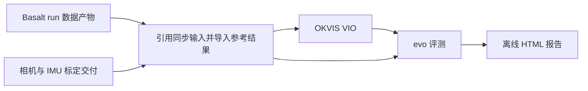

# 四相机 VIO 流水线使用说明

更新：2026-09-22。适用 OKVIS run 格式 `okvis-vio` / version 2。旧 OKVIS run 不兼容、不迁移；历史验证文档仅供查阅。

## 输入与运行边界

必填 `--basalt-run` 和 `--calibration-dir`。Basalt run 是数据来源：直接引用已准备的四相机/IMU 目录，实体复制已转换 GT、Basalt VIO 和来源记录。无需 Basalt 源码、Python 脚本、头文件或二进制，但输入数据目录及其图像链接目标必须持续可读。

支持 Basalt 旧平铺布局及 v5 布局；只要求 prepare、gt、vio 阶段有效，report/mapping 失败不影响数据读取。不校验物理 IMU 坐标系或 marker–IMU 标定一致性。GT 不再次变换、不再次应用时间偏移；时间对齐记录仅用于追溯。



## 构建与环境

```bash
cd /home/yuewang/Project/VSLAM/four_fisheye_rig/OKVIS2-X
./scripts/build_vio.sh
./scripts/test_vio.sh
```

本机 Python 为 `/home/yuewang/.local/share/pipx/venvs/evo/bin/python`，依赖版本见 `scripts/requirements-vio.txt`。便捷脚本允许通过 `PYTHON_BIN` 指定其它具备这些依赖的解释器。evo CLI 使用同一 Python 环境，GUI 需要 QtAgg/PyQt6 及可用图形桌面。C++ 相机有效域检查使用本工程头文件、系统 Eigen/OpenCV 编译。

## 完整运行

Layout0916 示例：

```bash
./scripts/run_layout0916_vio.sh \
  --basalt-run /home/yuewang/Project/VSLAM/four_fisheye_rig/basalt-monado/results/20260916_142602_203941_DOHC2_validation_01/run_20260918T151707_4586ee \
  --step all --run-name baseline
```

通用入口：

```bash
/home/yuewang/.local/share/pipx/venvs/evo/bin/python scripts/run_vio_pipeline.py \
  --basalt-run /绝对路径/Basalt结果目录 \
  --calibration-dir /绝对路径/delivery/vio/kalibr_handeye \
  --config config/oak4p/layout0916_vio.yaml \
  --step all
```

不接受旧 `--dataset`、`--baseline-run`、`--basalt-root`、`--gt-mode`。数据身份从 Basalt manifest/preparation 读取。相机时间参考必须与交付相符，分组参考引入的时间调整从 preparation 读取，并验证有效偏移；不重新同步相机。

`--camera-mask-dir` 指定四张 `cam0.png`–`cam3.png`，否则使用 Basalt run 的 mask；缺失时报错。输入灰度 ≤127 有效，>127 排除；转换为 OKVIS 非零有效的二值 mask。参数是 Kalibr pinhole-equi / KB4 / OKVIS Equidistant 的直接映射；有效域检查不是独立标定精度验证。

默认纯离线 VIO：关闭回环、最终 BA、在线外参和 CNN，关闭 GUI。`--show-gui` 只开启 OKVIS 显示；`--evo-show-gui` 在评测结束后依次打开 evo 指标和轨迹窗口。关闭当前窗口继续下一项。

`--vio-max-frames 300` 用于冒烟验证，仅在新 run 中建立截短索引视图，不修改来源索引。`--output` 指定结果基目录；每次生成唯一 run，失败结果保留。

## 分阶段、截段和补报告

`prepare` 完成输入检查、配置转换及参考结果导入。后续阶段用新格式 run 复用冻结输入，不能同时覆盖标定、mask、Basalt 来源或配置：

```bash
/home/yuewang/.local/share/pipx/venvs/evo/bin/python scripts/run_vio_pipeline.py \
  --from-run /绝对路径/新格式run --step all --vio-max-frames 0
```

`vio` 只跑 VIO；`compare` 复用已有 VIO 重评并生成报告。`all` 复用 prepare/reference 后重新跑 VIO。帧数上限默认沿用来源 run，显式 `0` 恢复全段。

截取前 44 秒、重新做子段 SE(3) 对齐并显示 evo GUI：

```bash
/home/yuewang/.local/share/pipx/venvs/evo/bin/python scripts/compare_vio_window.py \
  --run /绝对路径/新格式run --start 0 --end 44 --show-gui
```

输出保存到新的 `window_0_44s_*` 目录，不重新运行 VIO。时间以首个修正后输入图像为零。

只补生成报告，不重跑 VIO/evo，也不改 manifest：

```bash
/home/yuewang/.local/share/pipx/venvs/evo/bin/python scripts/generate_pipeline_report.py \
  --run /绝对路径/新格式run
```

等价入口为 `run_vio_pipeline.py --from-run /绝对路径/新格式run --step report`。

## 结果目录与口径

| 目录 | 内容 |
| --- | --- |
| `01_preparation/inputs` | 标定、默认/用户配置、原始 mask、来源记录 |
| `01_preparation/outputs` | 数据目录引用、有效标定、OKVIS 配置、转换后 mask |
| `01_preparation/diagnostics` | 本地相机模型审计、编译日志 |
| `02_reference/inputs` | GT、有效段、Basalt VIO、来源哈希及时间对齐记录 |
| `03_vio/inputs` | 实际 OKVIS 配置、可选截短索引 |
| `03_vio/outputs` | 原始及规范化轨迹、覆盖摘要 |
| `03_vio/logs`、`diagnostics` | 阶段日志、特征统计、墙钟/RSS |
| `04_vio_comparison/native` | 各自有效时间覆盖内的指标 |
| `04_vio_comparison/common` | 精确共同时间戳上的对比 |
| `04_vio_comparison/summary` | 完整统计 JSON、Markdown 概要 |
| `report` | 单文件 HTML、展示数据、来源及缺失信息 |
| `provenance` | 本地工具启动时快照及上游来源许可证 |

GT 保持原始整数纳秒，插值为位置线性与姿态 SLERP，无外推，默认最大间隔 50 ms，并尊重 GT 有效段。APE/RPE 使用 SE(3) 无尺度对齐；RPE 路程 0.1/0.5/1 m，容差 0.1、all_pairs、pairs_from_reference。无帧对明确标记；共同时间戳少于 5 时不生成比较结论。

`native` 可能覆盖不同时间长度，公平对照应查看 `common`。报告成功仅表示工程流程完成，不代表精度通过。资源统计含读取/初始化/收尾，系统负载和缓存未隔离。

报告的图片、CSS、JS 内嵌，无外部资源；配置搜索、明细和图像放大可离线使用。网页中的长整数在展示数据 JSON 中保存为字符串，避免 JavaScript 精度丢失。
