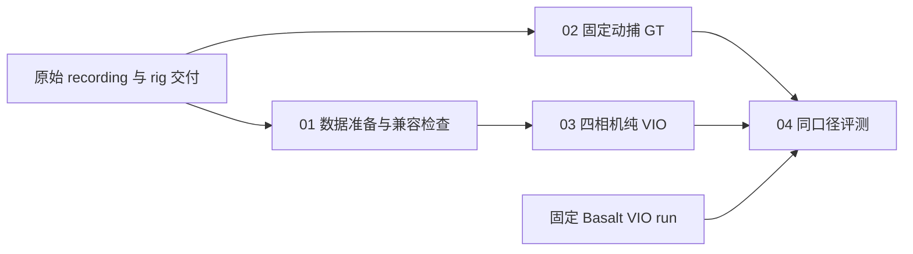

# OKVIS2-X 四相机离线 VIO 评测流水线实施计划

日期：2026-09-18；2026-09-20 开始实施。当前接口与命令见[使用说明](四相机VIO流水线使用说明.md)，实际结果见[实施与验证记录](20260920_四相机VIO实施与验证记录.md)。下文“已核实”“当前”等现状描述保留为 2026-09-18 的设计快照，拟定接口以使用说明为准。

## 🎯 目标与范围

为 OKVIS2-X 增加与 `basalt-monado/scripts/run_vio_pipeline.py` 相似的四阶段离线流程：数据准备 → 动捕 GT → 四相机 VIO → 轨迹评测。首个样例为 `20260916_142602_203941_DOHC2_validation_01`，使用完整 rig 标定交付，保留物理 `cam0..cam3` 顺序。

首版目标是可复现地跑完整段数据，并能与 Basalt 在相同输入、GT 和评测口径下比较。关闭回环、最终全局 BA、在线外参优化、神经网络与稠密建图。OKVIS2-X 仓库内的 `okvis_app_synchronous` 是首选入口；不需要先接入 `okvis2x_app_synchronous` 的深度/激光流程。首版不移植 Basalt mapper 或 `marg_data` 契约。

## 📁 已核实的样例与基线

以下路径相对于工作区 `/home/yuewang/Project/VSLAM/four_fisheye_rig`，原始数据与交付目录已确认存在。

| 项目 | 本次核实值 |
| --- | --- |
| 原始 recording | `/mnt/Datasets/VSLAM_benchmark/v0.1/OAK4pNew/Layout_0916/20260916_142602_203941_DOHC2_validation_01` |
| 用户所指 results | `basalt-monado/results/20260916_142602_203941_DOHC2_validation_01`，这是运行结果集合，不是原始 recording |
| 建议固定的对照 run | `run_20260918T151707_4586ee`，manifest 总状态及六个阶段均为 complete |
| 完整标定交付 | `/home/yuewang/Project/Calib/calibration_workspace/runs/layout0916_DOHC2_joint_dynamic_01_retry01/delivery/vio/kalibr_handeye` |
| Basalt 配置 | `data/oak4p_layout0916_vio_covisible_config.json`；实际比较以 run 内快照为准 |
| 相机 | 四路 KB4，均为 1280 × 800；时间参考 cam0 |
| 准备后的输入 | 2402 组；相机时间 44610110000–124644843000 ns，约 80.035 s |
| 相机组最大偏差 | preparation.json 记录为 50 μs |
| 相机到 IMU 时间偏移 | `cam_time_offset_ns = 3621516` |
| 基线 GT 插值结果 | 2402 个 VIO 位姿中接受 2401 个，跳过 1 个；这不是 OKVIS 的覆盖率 |
| 基线 mask | 已启用四张 mask，Basalt 约定为 0 有效、>127 排除 |
| 本次源码 HEAD | OKVIS2-X `38043e4`；Basalt `27ba150`；工作树状态须另行留档，HEAD 不代表现有 run 的构建版本 |

基线目录中另有不同配置及带/不带 mask 的历史 run。不得自动选“最新文件夹”或混合其标定、GT、轨迹。首版固定上述 run，使用 `03_vio/oak4p_trajectory.csv` 作 VIO 对照；mapper 输出仅可另列参考。

OKVIS2-X 当前没有 `build/`；已有 `run_t265.sh`、`config/t265/okvis2.yaml` 和 T265 五轨迹比较脚本，但后者依赖 mapper/T265 轨迹，不能作为本样例的动捕评测入口。当前已有未跟踪的 T265 配置/脚本，以及两个脏子模块，应保留并在实施前记录。

## 🔍 必须先完成的兼容性检查

### 相机模型与有效视场

`ViParametersReader.cpp` 支持 `pinhole + equidistant` 和 EUCM。本样例 KB4 的候选映射为 `fx,fy,cx,cy` 原值加 `k1..k4` 原序，不能直接宣称全视场等价：OKVIS `PinholeCamera` 对 `z<0` 返回 `Behind`，而 `EquidistantDistortion` 使用 `atan(r)`。

实施修订（2026-09-20）：原定两套反投影实现 < 1e-7 rad 的门槛未通过；核实差异来自 Basalt 固定 3 次 Newton 迭代。保留两端实际差值，新增收敛后的同一 KB4 方程作为反投影参考。全部有效像素上前向投影及收敛参考验证通过，未裁小视场或拟合参数。该修订允许算法比较，不宣称数值实现完全相等。

P0 需以真实内参和有效 mask 做像素网格及边缘采样，比较两套实现的投影、反投影、往返误差与有效性标志；额外覆盖近 90°、后半球及畸变多项式非单调区域。建议共同有效域中投影差 < 1e-5 px、bearing 角差 < 1e-7 rad，数值边界点单独报告。门限是转换验证建议值，不是轨迹精度验收值。

若当前有效像素超出 OKVIS 等价域，则阻断“同视场直接比较”。可选择实现完整 KB4 支持，或让两套算法使用同一受限有效域并重新运行 Basalt；后者必须标明改变了视场。不要将 KB4 参数改名成 EUCM，也不默认拟合或去畸变近似。已有 EUCM 支持可用于将来真实 EUCM 交付的独立实验。

### 外参、IMU 与时间

| 内容 | 首版约定与验证 |
| --- | --- |
| 外参 | 令 OKVIS 传感器系 S 等于物理 IMU 系 I，`T_SC = T_imu_cam`，逐相机转为行优先 4×4；用合成点验证变换方向及逆变换闭环，不能机械取逆 |
| 输出坐标系 | OKVIS CSV 写 `T_WS`；GT 必须是同一物理 IMU 原点的世界位姿，验证动捕 marker 杠杆臂转换方向 |
| 相机时间 | Basalt 使用 `t_imu = t_cam + offset`；OKVIS `ThreadedSlam::addImages` 使用 `stampCorrected = stamp - image_delay`，所以本例 `image_delay = -0.003621516` s |
| 偏移唯一性 | 首版保留准备后相机 CSV 的相机时钟，由 OKVIS 应用偏移一次；不得又预移 CSV 又设置非零 image_delay |
| 数值精度 | 所有 CSV 时间戳先按整数 ns 解析；导出 TUM 时用整数拆分秒与 9 位小数，禁止先 float 再还原 ns |
| IMU 格式 | `imu0/data.csv`：时间、wx wy wz、ax ay az；确认 rad/s、m/s² 及轴方向，不套用 T265 的 bias、重力或噪声参数 |
| 噪声映射 | 核对两端连续时间定义后，将 gyro/accel noise density 对应 `sigma_g_c/sigma_a_c`，bias random walk 对应 `sigma_gw_c/sigma_aw_c`；初始 bias prior 的 `sigma_bg/sigma_ba` 单独设置并记录 |
| 本例 IMU 标定 | 交付中 accel/gyro 校正数组均为零；密度候选值分别为 0.000282、0.016，随机游走候选值为 0.0001、0.001；不额外乘除采样率。非零校正或各向异性参数必须显式支持或报错 |

准备后 cam0 第一帧的预期 IMU 时刻是 `44613731516 ns`。用此数值检查 reader → estimator → 输出 CSV 的链路；若初始化跳过首帧，则检查首个实际输出对应的输入组，而不强求首行相等。

### 四相机同步与 mask

复用 Basalt 基于 `meta/camera_groups.csv` 的完整组筛选，将四路 CSV 的组时间统一为 cam0，保留各自真实图像文件映射，`sync_cameras: [0,1,2,3]`。先验证图片存在、尺寸匹配、时间单调、无重复、IMU 覆盖及组偏差。

OKVIS `DatasetReader.cpp` 当前 reader 同步容差硬编码为 10 ms，不能把 YAML 的 `timestamp_tolerance` 当作该 reader 的分组阈值。使用已经验证、时间完全相同的四路组避免 reader 再以宽松容差重配对，同时统计实际提交组数和丢组。

OKVIS `CameraBase::setMask` 的约定是 **0 排除、非零有效**，与 Basalt mask 相反。新增加载适配时明确取反并归档两种版本；核查 BRISK 检测、匹配与相机有效域路径均使用 mask，记录每相机有效面积和实际特征分布。仅将无效图像涂黑不能证明 mask 生效。当前没有核实到现成的四张 PNG 配置入口，实施时须接通并验证。

## 🧭 流水线设计



| 阶段 | 实现内容 | 主要产物与失败条件 |
| --- | --- | --- |
| `01_preparation` | 校验交付 schema/hash；复用准备逻辑或导入固定 Basalt prepare；生成 OKVIS YAML、mask、分组数据视图 | `preparation.json`、`calibration_conversion.json`、`okvis2.yaml`、`dataset/mav0`；模型、同步或 hash 不匹配即失败 |
| `02_mocap_alignment` | 默认从显式 Basalt run 复用完整 GT 及出处；独立模式调用现有对齐/转换工具 | 保留 `total_offset.json`、`state_groundtruth_estimate0/data.csv`、`conversion.json` 和标定快照；不能只拷一个 GT CSV |
| `03_vio` | blocking 离线运行、默认无 GUI；保存原始轨迹并转换为规范 CSV/TUM | `okvis2-vio_trajectory.csv`、`trajectory_euroc.csv`、`trajectory.tum`、日志及运行统计；空轨迹、非有限值、重复/逆序时间须显式失败或诊断 |
| `04_vio_comparison` | GT 插值、APE/RPE、轨迹图、覆盖率、Basalt 对照 | 原生有效区间和共同有效时间戳两组报告，`summary.json`、`report.md`、PNG、evo ZIP |

建议新建 `scripts/run_vio_pipeline.py`，支持 `--step all|prepare|gt|vio|compare`、`--dataset`、`--calibration-dir`、`--output`、`--config`、`--basalt-root`、`--baseline-run`、`--from-run`、`--run-name`、`--show-gui`、`--vio-max-frames`。这些是拟实现接口，当前不可执行。

`--baseline-run` 用于导入/验证 Basalt 的准备与 GT 产物及指定对照轨迹；`--from-run` 仅用于复用自身已完成阶段。数据、标定、mask、参考相机或起始范围发生变化时应拒绝复用。每次都分配新 run；保留失败 run，不覆盖原始数据、旧结果或基线配置。

建议输出结构：

```text
OKVIS2-X/results/20260916_142602_203941_DOHC2_validation_01/run_<时间>_<标识>/
  manifest.yaml
  01_preparation/
  02_mocap_alignment/
  03_vio/
  04_vio_comparison/
```

manifest 至少记录完整命令、cwd、阶段状态/退出码、数据/交付/输入索引哈希、脚本与二进制哈希、Git HEAD 和 dirty diff、子模块状态、构建参数、配置/mask 快照、数据来源 run、时间方程、轨迹种类、GUI/线程设置、运行耗时和软件版本。图像可用符号链接，须核验链接可读，并记录原始 checksum 清单；快速检查与全量图像校验分别标记。

## 🛠️ 实施步骤与交付文件

### P0：冻结输入并完成兼容性验证

1. 归档工作树和固定基线的 manifest、prepare/GT/配置/mask 来源，核查原始 recording 与交付哈希。
2. 新增 `scripts/convert_rig_to_okvis.py`：生成四相机 YAML、模型有效域报告、IMU/外参/时间映射报告。
3. 增加有意义的转换测试：物理相机顺序、四元数方向、错误模型拒绝、±时间偏移、整数 ns、大时间戳、mask 取反和非零 IMU 校正拒绝。
4. 投影共同有效域门槛未通过时先处理模型或统一视场，不进入精度排名。

完成标准：四相机参数加载无误，时间符号与外参方向有可复现数值证据，确定 mask/投影域方案。

### P1：构建并跑通短段

1. 使用独立 `build-vio/`，关闭不需要的组件；将词袋放到可执行文件同目录，记录其 hash。即使关闭回环，当前 app 仍检查词袋。
2. 新增 `config/oak4p/layout0916_vio.yaml` 作为算法参数模板，物理标定由转换器注入；不复制 T265 标定和 bias。
3. 设 `do_loop_closures=false`、`do_final_ba=false`、两项 `do_extrinsics*=false`、`enforce_realtime=false`、`use_cnn=false`、`mapping_rectification=false`；不设置非必要深度立体对，从而避免额外 rectification。
4. 默认关闭 `display_topview/display_matches/display_overhead/enable_submapping`，实际检查无显示服务器时是否仍触发 highgui；必要时给 app 增加 headless 分支。
5. 实现短段限制（当前 app 没有该 CLI）：可生成限制前 300 组的临时视图，并保留前后 IMU 支撑；不能只把参数原样传给旧 app。短段不足以初始化时延长并记录。
6. 接入 mask，跑通四相机加载、初始化、轨迹输出和正常退出；检查各相机都有观测参与，检查结尾队列是否处理完整。

建议构建命令（实施阶段执行，本次未执行）：

```bash
cd /home/yuewang/Project/VSLAM/four_fisheye_rig/OKVIS2-X
cmake -S . -B build-vio \
  -DCMAKE_BUILD_TYPE=Release -DBUILD_APPS=ON -DBUILD_ROS2=OFF \
  -DUSE_NN=OFF -DUSE_GPU=OFF -DHAVE_LIBREALSENSE=OFF -DDO_TIMING=ON
cmake --build build-vio --target okvis_app_synchronous -j8
cp resources/small_voc.yml.gz build-vio/small_voc.yml.gz
```

构建成功后才确认二进制实际位置；若配置阶段仍需要稠密模块依赖，评估最小 CMake 解耦并记录改动，不能预先声称这些开关已完全移除依赖。

### P2：实现四阶段调度与轨迹规范化

新增 `scripts/vio_pipeline_common.py`、`scripts/convert_okvis_trajectory.py` 和流水线测试。首版通过显式 `--basalt-root` 调用成熟的准备/GT/比较工具，并固定所调用脚本的 hash；不要直接实例化 Basalt 的 Run 类，后者包含 Basalt 二进制与 marg_data 假设。

OKVIS 原始 CSV 为整数 ns、px py pz、qx qy qz qw，再跟速度/bias 等列；EuRoC 规范输出调整为 qw qx qy qz。主评测轨迹固定为运行期 `okvis2-vio_trajectory.csv`；`*-final_trajectory.csv` 和 `*-final-ba_trajectory.csv` 独立归档，不用于替换主轨迹。当前 app 即使关闭 final BA 也写 final-ba 名称文件，因此必须同时看配置与输出语义。

异常重复时间戳不能无记录地排序去重；若发现 callback 重复，先查清语义，制定可审计规则。规范化验证包括四元数范数、有限值、时间单调、输出位姿数、首末时间、最大输出间隙及输入组对应关系。

### P3：完整样例与 Basalt 对照

先执行 2402 组完整回放，再对比固定基线。运行期主轨迹应覆盖初始化后的完整输入区间；报告初始化延迟、缺失组和结束缺口，不强求所有输入组都产生位姿，也不以退出码 0 代替覆盖检查。

现有评测工具复用策略：

| 工具 | 用途与限制 |
| --- | --- |
| `prepare_multicam_vio.py`、`rig_calibration.py` | 四相机分组和完整交付校验；生成的 Basalt JSON 供转换器读取，不作为 OKVIS YAML |
| `prepare_mocap_alignment.py`、`run_mocap_time_alignment.sh`、`convert_mocap_to_euroc_groundtruth.py` | 独立 GT 模式；native 对齐工具依赖也须检查。对照时优先复用固定结果，不分别重新估计 offset |
| `interpolate_mocap_to_vio.py`、`compare_oak4p_vio_mocap.sh`、`extend_evo_stats.py` | 单算法评测；四元数、时间戳格式转换完成后再调用 |
| 新增 `compare_vio_runs.py` | 生成两算法共同有效时间戳集合与并排汇总；不能只拼接不同样本集的旧汇总 |

固定 GT 的 `raw_mocap_to_imu_total_offset_ns = -1789539918207227402`。该值属于本 recording，不能用于其他录制。GT 的 invalid-segment 信息和最大插值间隔 50 ms 必须保留；不跨无效段、不外推，也不利用任一 VIO 轨迹拟合新的时间偏移。

位置 APE 使用 SE(3) 刚体对齐，不校正尺度；RPE 复用现有 0.1/0.5/1 m GT 路程间隔、10% 距离容差、`all_pairs` 与 `pairs_from_reference`。GT 插值后匹配容差保持 1 ns。报告 RMSE、median、p95、max、样本数及 RPE pair 数；姿态误差作为额外明确命名指标，不混入位置指标。

同时输出各算法自身有效覆盖范围的结果和严格共同时间戳结果。共同时间戳不足时报告无法公平比较，不对缺失 VIO 位姿做长间隔补线。补充起始固定窗口的对齐后误差曲线，并明确该窗口和全程 SE(3) 对齐是两种实验。为避免长段均值掩盖启动/局部问题，列出启动段、45–55 s 等区间，时间原点统一定义为本次评测首个输入组。

Basalt 基线带 mask，因此 mask 或有效视场未匹配的 OKVIS 结果只能标为不同输入条件的探索结果。若需要无 mask 对照，应新建 Basalt run；不得改旧 run。

### P4：性能与可复现性补充

首版记录 VIO 进程墙钟时间、峰值 RSS、输入/输出帧数、数据时长和墙钟实时因子，单独记录准备、GT 和绘图耗时。当前 OKVIS 汇总 timer 日志不等于 Basalt 逐帧 CSV；逐帧 tracing 可作为后续独立任务，明确覆盖范围，避免嵌套/异步耗时相加。

固定 Release、GUI、线程数、CPU/存储条件后至少重复三次，精度/覆盖率与性能都保留各次结果。记录缓存状态；没有受控实验时不归因于网络盘或 SSD。不要为对齐性能数字而声称两端线程配置语义相同。

## 🚀 目标使用方式

以下是 **P2 完成后的拟定命令**，脚本及参数尚待实现，不能现在直接运行：

```bash
python3 /home/yuewang/Project/VSLAM/four_fisheye_rig/OKVIS2-X/scripts/run_vio_pipeline.py \
  --dataset /mnt/Datasets/VSLAM_benchmark/v0.1/OAK4pNew/Layout_0916/20260916_142602_203941_DOHC2_validation_01 \
  --calibration-dir /home/yuewang/Project/Calib/calibration_workspace/runs/layout0916_DOHC2_joint_dynamic_01_retry01/delivery/vio/kalibr_handeye \
  --basalt-root /home/yuewang/Project/VSLAM/four_fisheye_rig/basalt-monado \
  --baseline-run /home/yuewang/Project/VSLAM/four_fisheye_rig/basalt-monado/results/20260916_142602_203941_DOHC2_validation_01/run_20260918T151707_4586ee \
  --config /home/yuewang/Project/VSLAM/four_fisheye_rig/OKVIS2-X/config/oak4p/layout0916_vio.yaml \
  --output /home/yuewang/Project/VSLAM/four_fisheye_rig/OKVIS2-X/results/20260916_142602_203941_DOHC2_validation_01 \
  --step all --run-name baseline
```

默认无 GUI、全段、四相机。短段实验显式追加 `--vio-max-frames 300` 并用不同 run-name；首版不设置需要用户重新拼接 camera chain 的入口。

## ✅ 验收与边界

- [x] P0：真实四相机模型共同有效域、外参、时间、IMU、mask 语义均有验证记录。
- [x] P1：Release 构建及 headless 短段成功，四相机确实参与，输出可读且时间正确。
- [x] P2：一条命令完成四阶段；单阶段复用来源可追踪；失败保留日志和 manifest；原始数据及基线不改动。
- [x] P3：完整样例跑完；输出覆盖、初始化延迟和异常明确；相同 GT/时间集合/尺度策略下生成 Basalt 对照。
- [x] P4：重复运行产物、耗时统计和配置差异清楚可查。

2026-09-20 验收结果：上述工程阶段完成；三次同配置全段输出完整，但 APE RMSE 为 190.73/198.87/0.819 m，当前精度与稳定性不通过。P0 采用上文明确记录的数值迭代差异修订；P4 为缓存/系统负载未隔离的描述性重复统计。

流程验收与精度验收分开：本计划不预设 OKVIS 必须胜过 Basalt，也不凭一个 validation recording 宣称跨场景准确度。若在此数据上调参，须标记开发集使用，再用独立 recording 验证。

## 🔗 本地核查依据

以上行为判断来自当前工作树，实施时需再核对版本；本次没有依赖在线文档推断接口。

- [Basalt 四阶段/六阶段调度](../../../basalt-monado/scripts/vio_pipeline_common.py)、[四相机准备](../../../basalt-monado/scripts/prepare_multicam_vio.py)、[完整 rig 读取](../../../basalt-monado/scripts/rig_calibration.py)。
- [固定基线 manifest](../../../basalt-monado/results/20260916_142602_203941_DOHC2_validation_01/run_20260918T151707_4586ee/manifest.yaml)、[准备记录](../../../basalt-monado/results/20260916_142602_203941_DOHC2_validation_01/run_20260918T151707_4586ee/01_preparation/preparation.json)、[评测脚本](../../../basalt-monado/scripts/compare_oak4p_vio_mocap.sh)。
- [OKVIS 离线 app](../../okvis_apps/src/okvis_app_synchronous.cpp)、[参数解析](../../okvis_common/src/ViParametersReader.cpp)、[数据读取](../../okvis_multisensor_processing/src/DatasetReader.cpp)、[时间偏移应用](../../okvis_multisensor_processing/src/ThreadedSlam.cpp)、[轨迹输出](../../okvis_multisensor_processing/src/TrajectoryOutput.cpp)。
- [PinholeCamera 投影有效域](../../okvis_cv/include/okvis/cameras/implementation/PinholeCamera.hpp)、[Equidistant 畸变](../../okvis_cv/include/okvis/cameras/implementation/EquidistantDistortion.hpp)、[mask 约定](../../okvis_cv/include/okvis/cameras/CameraBase.hpp)、[构建选项](../../CMakeLists.txt)。
